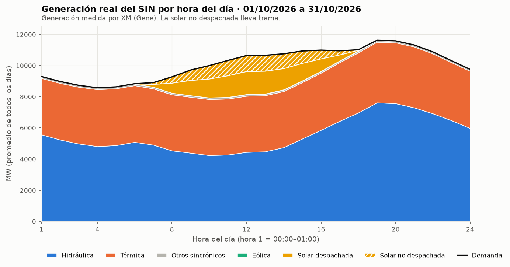
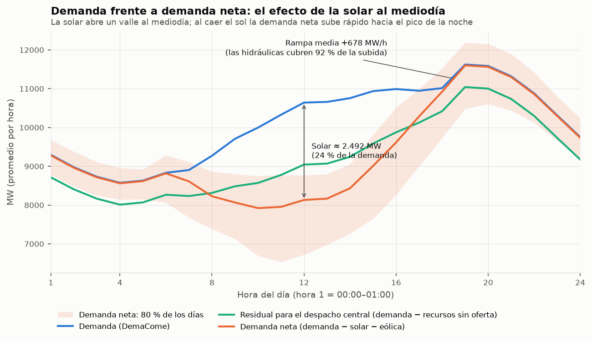
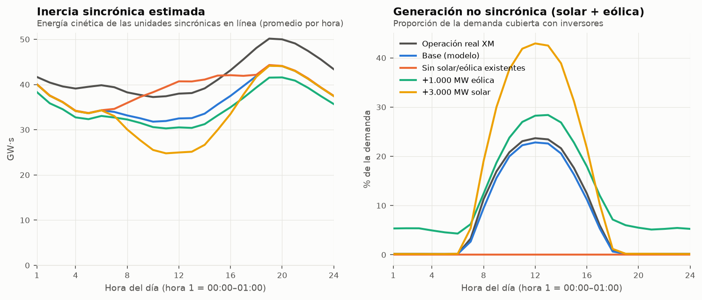
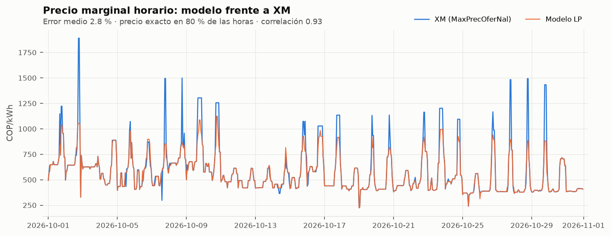
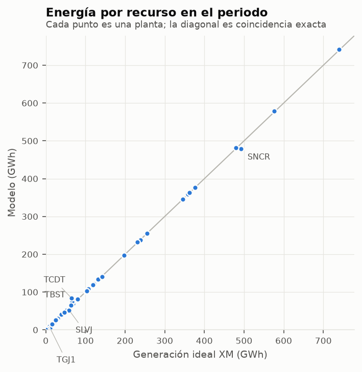
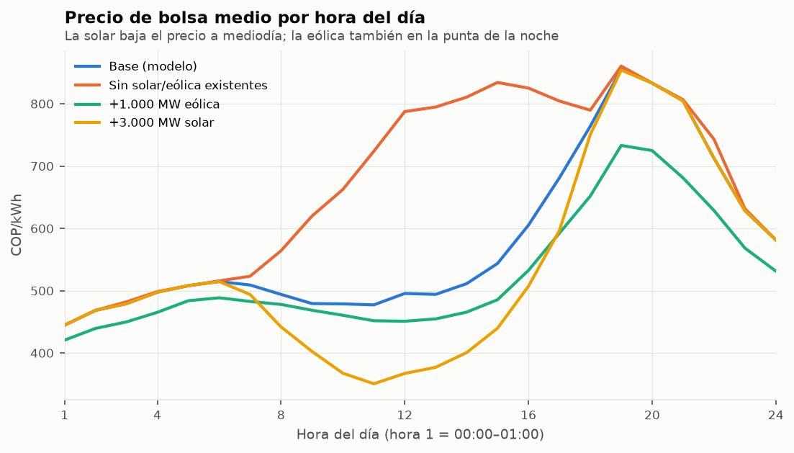
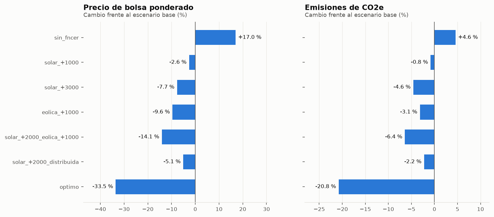
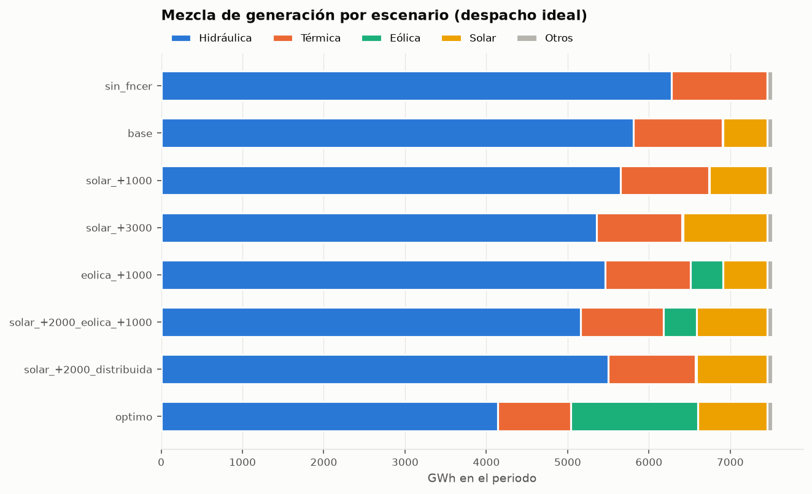
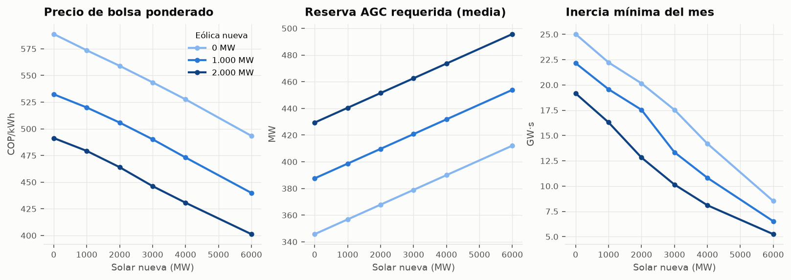

# Despacho del SIN con y sin FNCER — 01/10/2026 a 31/10/2026

1. [Datos usados](#1-datos-usados) · 2. [Comportamiento real del SIN](#2-comportamiento-real-del-sin) · 3. [Demanda y solar del mediodía](#3-demanda-y-solar-del-mediodía) · 4. [Inercia](#4-inercia-y-generación-no-sincrónica) · 5. [Validación](#5-validación-del-modelo) · 6. [Escenarios](#6-escenarios) · 7. [Entrada óptima](#7-entrada-óptima-de-fncer) · 8. [Sensibilidad de reserva](#8-sensibilidad-al-requerimiento-de-reserva) · 9. [Supuestos](#9-supuestos-y-limitaciones)

## 1. Datos usados

- **Días:** 01/10/2026 a 31/10/2026, **31 días** consecutivos (22 laborables, 5 sábados y 4 domingos). No se excluyó ningún día.
- **Resolución horaria:** 744 horas. La hora 1 va de 00:00 a 01:00 (convención de XM). Cuando un gráfico dice "por hora del día", es el promedio de esa hora en todos los días del periodo. Las fechas con hora (p. ej. 2026-10-15 18:00) marcan el **inicio** de la hora: 18:00 es la hora 19 de XM.
- **Cada día con sus propios datos:** ofertas, disponibilidad, inflexibilidades y solar de ese día. No hay un día típico: el modelo recorre las horas reales una por una.
- **Descarga:** 06/11/2026. XM puede revisar cifras después; de SIMEM se usa la versión de liquidación más reciente.

| Variable | Métrica | Fuente | Resolución | Unidad | Uso |
|---|---|---|---|---|---|
| Demanda | DemaCome (Sistema) | API XM | horaria | kWh | Demanda que se debe atender cada hora |
| Generación real | Gene (Recurso) | API XM | horaria | kWh | Comportamiento real, perfiles solar y eólico, factor de CO2, inercia real |
| Generación ideal | GeneIdea (Recurso) | API XM | horaria | kWh | Inyección fija de los recursos sin oferta y referencia de validación |
| Precio de oferta | PrecOferIdeal (respaldo PrecOferDesp) | API XM | diaria | COP/kWh | Costo de cada planta en el LP |
| Disponibilidad | DispoCome (Recurso) | API XM | horaria | kW | Límite superior de cada planta |
| Precios de referencia | MaxPrecOferNal, PrecBolsNaci | API XM | horaria | COP/kWh | Validación del precio y ΔI |
| Recurso marginal | IndRecMargina (Recurso) | API XM | horaria | indicador | Validación |
| Capacidad | CapEfecNeta (Recurso) | API XM | diaria | kW | Perfiles FNCER y tamaño de unidad |
| Emisiones | EmisionesCO2Eq (Recurso) | API XM | horaria | tCO2e | Factor de emisión por planta |
| Operación real | GeneSeguridad, GeneFueraMerito | API XM | horaria | kWh | Explicar real frente a ideal |
| Atributos | ListadoRecursos | API XM | listado | - | Tipo, despacho central y clase (AGPE, GD, menor) |
| Reserva AGC | Holgura AGC (897043, HOArribaG) | SIMEM | horaria | kWh | Requerimiento base y plantas AGC |
| Inflexibilidades | Inflexibilidad proceso comercial (FE1E73) | SIMEM | horaria | kWh | Piso de generación |
| Unidades | Listado de unidades de generación (670221) | SIMEM | diaria | - | Unidades por planta (inercia) |

## 2. Comportamiento real del SIN

Datos medidos por XM, sin modelo. Demanda total **7.523 GWh**, media **10.111 MW** y máxima **12.401 MW** (2026-10-15 18:00). El pico diario promedio cae en la hora 19 (18:00–19:00). Precio de bolsa medio: **601 COP/kWh**.

### 2.1 Operación real frente al despacho ideal

En la operación física, las térmicas aportaron **36 %** de la energía, pero el despacho ideal (sin red, el que fija el precio de bolsa) solo les asignaba **14 %**. La diferencia está en lo que XM registra para las térmicas como generación **fuera de mérito (1.672 GWh)** y **de seguridad (615 GWh)**: energía que la operación real necesitó por restricciones de la red y del sistema, y que el despacho ideal no ve. El modelo reproduce el despacho ideal, así que su mezcla se compara con la columna *Ideal*, no con la *Real*.

| Tipo | Real GWh | Ideal GWh | Seguridad GWh | Fuera de mérito GWh | Real % | Ideal % |
|---|---|---|---|---|---|---|
| COGENERADOR | 70,0 | 70,0 | 0,0 | 0,0 | 0,9 | 0,9 |
| EOLICA | 12,4 | 12,4 | 0,0 | 0,0 | 0,2 | 0,2 |
| HIDRAULICA | 4.123,1 | 5.823,8 | 250,5 | 36,6 | 54,8 | 77,4 |
| SOLAR | 577,0 | 539,4 | 26,6 | 38,4 | 7,7 | 7,2 |
| TERMICA | 2.739,9 | 1.076,9 | 615,2 | 1.672,1 | 36,4 | 14,3 |
| TOTAL | 7.522,4 | 7.522,6 | 892,4 | 1.747,2 | 100,0 | 100,0 |

### 2.2 Perfil promedio por hora

Valores en MW (promedio de todos los días para cada hora).

| Hora | Demanda | Hidráulica | Térmica | Solar desp. | Solar no desp. | Eólica | Demanda neta | Bolsa COP/kWh | Inercia GW·s |
|---|---|---|---|---|---|---|---|---|---|
| 1 | 9.295 | 5.570 | 3.614 | 0 | 0 | 16 | 9.279 | 448 | 41,7 |
| 2 | 8.976 | 5.237 | 3.627 | 0 | 0 | 15 | 8.961 | 467 | 40,4 |
| 3 | 8.730 | 4.979 | 3.639 | 0 | 0 | 15 | 8.716 | 481 | 39,6 |
| 4 | 8.575 | 4.814 | 3.650 | 0 | 0 | 13 | 8.562 | 497 | 39,1 |
| 5 | 8.630 | 4.875 | 3.646 | 0 | 1 | 12 | 8.618 | 511 | 39,5 |
| 6 | 8.833 | 5.087 | 3.632 | 0 | 3 | 12 | 8.818 | 517 | 39,8 |
| 7 | 8.904 | 4.908 | 3.606 | 175 | 108 | 10 | 8.611 | 511 | 39,4 |
| 8 | 9.272 | 4.540 | 3.593 | 639 | 397 | 9 | 8.227 | 492 | 38,3 |
| 9 | 9.709 | 4.393 | 3.582 | 971 | 662 | 9 | 8.067 | 479 | 37,7 |
| 10 | 9.997 | 4.240 | 3.590 | 1.207 | 856 | 12 | 7.922 | 477 | 37,2 |
| 11 | 10.328 | 4.274 | 3.588 | 1.381 | 978 | 15 | 7.954 | 475 | 37,4 |
| 12 | 10.642 | 4.443 | 3.599 | 1.469 | 1.023 | 18 | 8.132 | 492 | 38,0 |
| 13 | 10.660 | 4.479 | 3.596 | 1.458 | 1.016 | 19 | 8.166 | 488 | 38,1 |
| 14 | 10.756 | 4.747 | 3.596 | 1.353 | 947 | 21 | 8.435 | 512 | 39,1 |
| 15 | 10.938 | 5.303 | 3.615 | 1.116 | 789 | 22 | 9.010 | 533 | 41,0 |
| 16 | 10.991 | 5.860 | 3.663 | 796 | 555 | 24 | 9.616 | 612 | 43,2 |
| 17 | 10.947 | 6.433 | 3.762 | 377 | 259 | 23 | 10.287 | 708 | 45,6 |
| 18 | 11.014 | 6.972 | 3.857 | 38 | 31 | 23 | 10.922 | 827 | 48,1 |
| 19 | 11.623 | 7.617 | 3.889 | 0 | 2 | 22 | 11.600 | 1.054 | 50,2 |
| 20 | 11.585 | 7.565 | 3.904 | 0 | 2 | 20 | 11.564 | 1.000 | 50,0 |
| 21 | 11.320 | 7.296 | 3.908 | 0 | 2 | 18 | 11.299 | 869 | 49,1 |
| 22 | 10.878 | 6.918 | 3.844 | 0 | 1 | 18 | 10.859 | 764 | 47,4 |
| 23 | 10.312 | 6.477 | 3.720 | 0 | 0 | 18 | 10.294 | 627 | 45,5 |
| 24 | 9.752 | 5.976 | 3.663 | 0 | 0 | 16 | 9.735 | 581 | 43,4 |

### 2.3 Resumen por día

La hora máxima usa la convención de XM (hora 19 = 18:00–19:00). Los fines de semana y el lunes festivo 12/10 (Día de la Raza) tienen menos demanda, así que su participación solar es mayor y su inercia mínima, más baja.

| Fecha | Día | Demanda GWh | Dem. máx MW | Hora máx | Solar GWh | Solar máx % | Neta mín MW | Rampa máx MW/h | Bolsa media | Inercia mín GW·s |
|---|---|---|---|---|---|---|---|---|---|---|
| 01/10 | jueves | 253,2 | 12.149 | 20 | 20,3 | 24,0 | 8.171 | 803 | 758 | 38,3 |
| 02/10 | viernes | 254,4 | 11.924 | 19 | 15,9 | 20,1 | 8.776 | 900 | 790 | 40,4 |
| 03/10 | sábado | 234,1 | 10.990 | 19 | 14,0 | 18,6 | 8.262 | 784 | 659 | 38,5 |
| 04/10 | domingo | 215,9 | 10.637 | 20 | 18,5 | 29,7 | 6.255 | 1.053 | 639 | 31,2 |
| 05/10 | lunes | 249,3 | 12.019 | 19 | 21,2 | 23,6 | 8.004 | 919 | 601 | 37,4 |
| 06/10 | martes | 249,7 | 11.801 | 20 | 17,7 | 21,2 | 8.416 | 764 | 590 | 38,8 |
| 07/10 | miércoles | 245,3 | 11.638 | 19 | 15,8 | 22,1 | 8.345 | 727 | 638 | 38,4 |
| 08/10 | jueves | 247,4 | 11.927 | 19 | 19,5 | 25,3 | 7.966 | 829 | 768 | 36,2 |
| 09/10 | viernes | 251,8 | 12.029 | 19 | 22,1 | 26,3 | 7.983 | 994 | 851 | 38,0 |
| 10/10 | sábado | 238,3 | 11.324 | 19 | 16,7 | 25,4 | 7.608 | 851 | 760 | 35,3 |
| 11/10 | domingo | 219,5 | 10.538 | 20 | 21,5 | 30,6 | 6.089 | 1.072 | 540 | 29,5 |
| 12/10 | lunes | 219,4 | 10.515 | 20 | 14,5 | 24,5 | 6.979 | 920 | 519 | 32,8 |
| 13/10 | martes | 235,5 | 11.353 | 19 | 12,9 | 18,6 | 7.964 | 560 | 526 | 35,7 |
| 14/10 | miércoles | 244,4 | 12.033 | 19 | 24,5 | 29,0 | 7.253 | 1.099 | 527 | 34,0 |
| 15/10 | jueves | 255,1 | 12.401 | 19 | 25,0 | 27,8 | 7.470 | 1.007 | 636 | 35,7 |
| 16/10 | viernes | 260,3 | 12.354 | 19 | 19,6 | 23,9 | 8.631 | 837 | 730 | 39,0 |
| 17/10 | sábado | 241,1 | 11.301 | 19 | 18,1 | 24,4 | 7.738 | 715 | 636 | 36,3 |
| 18/10 | domingo | 217,2 | 10.568 | 20 | 16,3 | 28,0 | 6.489 | 911 | 487 | 31,7 |
| 19/10 | lunes | 246,0 | 12.052 | 19 | 20,0 | 24,1 | 7.825 | 695 | 523 | 36,4 |
| 20/10 | martes | 248,4 | 11.854 | 19 | 17,5 | 22,3 | 7.975 | 915 | 549 | 38,4 |
| 21/10 | miércoles | 245,3 | 11.668 | 19 | 12,4 | 17,9 | 8.609 | 734 | 486 | 38,7 |
| 22/10 | jueves | 249,5 | 12.148 | 19 | 21,2 | 25,1 | 7.960 | 910 | 620 | 37,0 |
| 23/10 | viernes | 256,0 | 12.353 | 19 | 23,5 | 27,1 | 7.594 | 1.019 | 656 | 36,4 |
| 24/10 | sábado | 237,0 | 10.973 | 19 | 11,3 | 14,7 | 8.514 | 549 | 607 | 38,0 |
| 25/10 | domingo | 218,0 | 10.749 | 20 | 19,9 | 27,8 | 6.024 | 898 | 420 | 31,2 |
| 26/10 | lunes | 245,7 | 11.938 | 19 | 16,6 | 22,1 | 8.204 | 863 | 539 | 39,1 |
| 27/10 | martes | 247,9 | 12.012 | 19 | 16,5 | 22,6 | 8.367 | 755 | 555 | 38,7 |
| 28/10 | miércoles | 251,8 | 12.155 | 19 | 21,7 | 24,7 | 7.976 | 989 | 532 | 38,1 |
| 29/10 | jueves | 253,9 | 12.221 | 19 | 20,2 | 22,4 | 8.421 | 1.012 | 573 | 40,1 |
| 30/10 | viernes | 254,3 | 12.107 | 19 | 22,5 | 25,9 | 7.741 | 861 | 510 | 38,2 |
| 31/10 | sábado | 236,9 | 11.029 | 19 | 19,9 | 27,3 | 7.605 | 866 | 406 | 37,0 |

## 3. Demanda y solar del mediodía

### 3.1 Qué muestran los datos

- La solar llega a su máximo en la **hora 12 (11:00–12:00)**: en promedio **2.492 MW**, el **24 %** de la demanda de esa hora (10.642 MW). De eso, **1.023 MW** son solar que XM no despacha (plantas menores, GD, AGPE, autogeneradores).
- Con la solar descontada, la demanda neta del mediodía baja a **8.132 MW**. El mínimo del mes fue **6.024 MW** (2026-10-25 08:00).
- La participación solar instantánea más alta fue **30,6 %** (2026-10-11 10:00).
- Al caer el sol, la demanda neta sube **678 MW/h** en promedio en la hora 19 (18:00–19:00). La rampa horaria más fuerte del mes fue de **1.099 MW/h** (2026-10-14 17:00).
- Entre la hora 12 y la 19 la demanda neta sube en promedio **3.467 MW**: las hidráulicas aportan **3.173 MW (92 %)** y las térmicas 290 MW. La flexibilidad de los embalses es lo que absorbe hoy el efecto de la solar.

| Categoría | Energía GWh | Pico MW | Media 12-13 h MW | % demanda 12-13 h |
|---|---|---|---|---|
| Solar despachada | 340,4 | 1.851 | 1.458 | 13,7 |
| Solar AGPE | 0,1 | 1 | 1 | 0,0 |
| Solar GD | 31,9 | 165 | 135 | 1,3 |
| Solar planta menor | 195,3 | 1.033 | 832 | 7,8 |
| Solar autogenerador | 9,3 | 76 | 49 | 0,5 |
| Total solar | 577,0 | 3.036 | 2.474 | 23,3 |

### 3.2 Cómo lo considera el modelo

1. **Demanda:** es `DemaCome`, medida en las fronteras comerciales, hora a hora y día a día. El autoconsumo de los autogeneradores detrás del medidor no aparece en ningún dato de XM: ya viene descontado de esa demanda.
2. **Solar no despachada** (plantas menores, GD, AGPE, autogeneradores): no oferta precio. Entra como inyección obligatoria igual a lo que generó cada hora real y se resta de la demanda. Así el valle del mediodía queda en el modelo tal como ocurrió, sin promedios ni día típico.
3. **Solar despachada** (las plantas grandes): oferta precio (~76 COP/kWh) y entra por orden de mérito con su disponibilidad horaria. Como es la oferta más barata, se despacha completa casi siempre.
4. **Lo que cubre el despacho central** es la demanda residual (línea aqua del gráfico): demanda menos todo lo que no oferta. Esa es la que se reparte entre hidráulicas, térmicas y solar despachada al menor costo.
5. **Escenarios con más solar:** en modo *distribuida*, la nueva solar se suma a la inyección obligatoria con el perfil horario real de la flota, lo que hunde más el valle. Si el sistema ya no puede bajar más (inflexibilidades), el excedente se vierte. En modo *despachada* la nueva solar oferta precio y se puede recortar.

## 4. Inercia y generación no sincrónica

**XM y SIMEM no publican la inercia del sistema** (se revisaron los catálogos completos). Se estima así: E = Σ H·S de las unidades sincrónicas en línea cada hora. El número de unidades sale del listado de SIMEM (670221) y la generación de cada planta; H es un valor típico por tecnología (hidráulica 3 s, térmica 4 s), editable en `config.yaml`. Se supone el mínimo de unidades necesario, así que **es una cota inferior**. Solar y eólica (inversores) aportan cero.

- Operación real de octubre: inercia media **42,0 GW·s**, mínima **29,5 GW·s** (2026-10-11 10:00), máxima 53,4 GW·s.
- La inercia más baja ocurre en las horas de sol (en promedio, hora 10 (09:00–10:00)), cuando la solar desplaza hidráulicas. La generación no sincrónica llegó a **30,9 %** de la demanda.
- Constante de inercia equivalente mínima del sistema: **3,3 s** sobre la demanda.
- La inercia del modelo sale del despacho ideal, que usa menos térmicas que la operación real (sección 2.1). Por eso queda **por debajo** de la real: compara los escenarios entre sí, no contra la línea gris.

| Escenario | Inercia media GW·s | Inercia mín GW·s | Cuándo | H mín s | No sincr. 12-13 h % | No sincr. máx % |
|---|---|---|---|---|---|---|
| sin_fncer | 39,2 | 29,9 | 2026-10-25 06:00 | 3,7 | 0,0 | 0,0 |
| base | 36,7 | 25,0 | 2026-10-11 09:00 | 2,8 | 22,6 | 30,4 |
| solar_+1000 | 36,0 | 22,2 | 2026-10-25 09:00 | 2,5 | 29,2 | 39,1 |
| solar_+3000 | 34,4 | 17,5 | 2026-10-11 10:00 | 2,0 | 42,5 | 56,5 |
| eolica_+1000 | 34,9 | 22,2 | 2026-10-11 09:00 | 2,5 | 28,4 | 40,6 |
| solar_+2000_eolica_+1000 | 33,3 | 17,5 | 2026-10-11 10:00 | 1,9 | 41,7 | 58,0 |
| solar_+2000_distribuida | 35,2 | 20,2 | 2026-10-11 10:00 | 2,3 | 35,9 | 47,8 |
| optimo | 27,8 | 7,7 | 2026-10-11 10:00 | 0,8 | 58,3 | 86,0 |

## 5. Validación del modelo

El modelo se compara con el despacho ideal publicado por XM (mismo planteamiento: uninodal y sin AGC).

- Veredicto: **ACEPTADO**
- Precio marginal: error medio **2,8 %**, MAE 29,4 COP/kWh, sesgo -23,4 COP/kWh, exacto en 80 % de las horas.
- Precio de bolsa medio: modelo 577,6 frente a XM 600,9 COP/kWh.
- Energía diaria por planta: error ponderado **1,6 %**. Recurso marginal igual al de XM en 80 % de las horas.
- El error se concentra en las puntas de 18 a 20 h: el LP no tiene arranques ni mínimos técnicos de las térmicas.

| Tecnología | Modelo GWh | XM ideal GWh | Diferencia GWh | Diferencia % |
|---|---|---|---|---|
| HIDRAULICA | 5.498,4 | 5.515,2 | -16,8 | -0,3 |
| TERMICA | 1.062,6 | 1.046,4 | 16,2 | 1,5 |
| SOLAR | 301,2 | 300,6 | 0,7 | 0,2 |

## 6. Escenarios

Cada escenario usa los mismos días y horas del periodo. El precio sale del despacho ideal y la reserva de una segunda corrida con AGC co-optimizado.

| Escenario | Solar nueva MW | Eólica nueva MW | Bolsa COP/kWh | Δ precio % | Bolsa 18-21 h | FNCER % | ktCO2e | Δ emis. % | Vertim. % | Reserva MW | Costo reserva mil M COP |
|---|---|---|---|---|---|---|---|---|---|---|---|
| sin_fncer | 0 | 0 | 689 | 17,0 | 833 | 0,0 | 950 | 4,6 | 0,0 | 308 | 6,9 |
| base | 0 | 0 | 589 | 0,0 | 831 | 7,3 | 908 | 0,0 | 0,0 | 346 | 3,9 |
| solar_+1000 | 1.000 | 0 | 574 | -2,6 | 831 | 9,5 | 901 | -0,8 | 0,0 | 357 | 3,7 |
| solar_+3000 | 3.000 | 0 | 544 | -7,7 | 831 | 13,9 | 866 | -4,6 | 0,0 | 379 | 3,5 |
| eolica_+1000 | 0 | 1.000 | 532 | -9,6 | 713 | 12,5 | 879 | -3,1 | 0,0 | 388 | 0,9 |
| solar_+2000_eolica_+1000 | 2.000 | 1.000 | 506 | -14,1 | 713 | 16,9 | 850 | -6,4 | 0,0 | 410 | 0,9 |
| solar_+2000_distribuida | 2.000 | 0 | 559 | -5,1 | 831 | 11,7 | 888 | -2,2 | 0,0 | 368 | 3,6 |
| optimo | 1.897 | 4.000 | 391 | -33,5 | 546 | 32,1 | 719 | -20,8 | 0,1 | 534 | 0,3 |

## 7. Entrada óptima de FNCER

Solar **1.897 MW** (límite 8.000), eólica **4.000 MW** (límite 4.000). LCOE implícito: solar 195 COP/kWh y eólica 165 COP/kWh. Si una tecnología queda en su límite, el resultado lo fija el límite y no el costo: revisa los supuestos.

## 8. Sensibilidad al requerimiento de reserva

Escenario: `solar_+2000_eolica_+1000`. Factor = MW de AGC exigidos por MW de FNCER nueva generado.

| factor_reserva | reserva_req_media_MW | reserva_req_max_MW | reserva_costo_milmill_COP | reserva_precio_medio_subir_COP_kWh | reserva_horas_precio_positivo | reserva_horas_faltante | reserva_faltante_MWh |
|---|---|---|---|---|---|---|---|
| 0,00 | 345,75 | 508,00 | 0,76 | 4,58 | 19 | 0 | 0,00 |
| 0,05 | 394,00 | 562,32 | 0,85 | 4,93 | 21 | 0 | 0,00 |
| 0,10 | 442,26 | 620,02 | 0,94 | 5,38 | 26 | 0 | 0,00 |
| 0,20 | 538,76 | 888,04 | 1,22 | 7,40 | 32 | 0 | 0,00 |
| 0,30 | 635,27 | 1.156,06 | 1,62 | 9,59 | 38 | 0 | 0,00 |

## 9. Supuestos y limitaciones

- Red uninodal, como el despacho ideal: sin transmisión, sin generación de seguridad ni fuera de mérito (sección 2.1).
- LP: sin arranques, mínimos técnicos ni rampas térmicas (subestima algunas puntas).
- Hidráulicas a su precio de oferta diario; el agua desplazada no se traslada a otros días.
- Perfil eólico de solo dos parques en pruebas (Guajira I y WESP01): factor de planta probablemente alto.
- Factores de reserva, costos de inversión y constantes H son supuestos editables (`config.yaml`, hoja `9_Supuestos`).

## Archivos

- `resultados_despacho.xlsx`: hojas numeradas igual que estas secciones; `H_<escenario>` con las 744 horas.
- `powerfactory/generacion_real_XM.csv`: generación real por planta (MW/hora), el caso más representativo para estudios de red.
- `powerfactory/despacho_modelo_<escenario>.csv`: despacho del modelo por planta con oferta + FNCER nueva.
